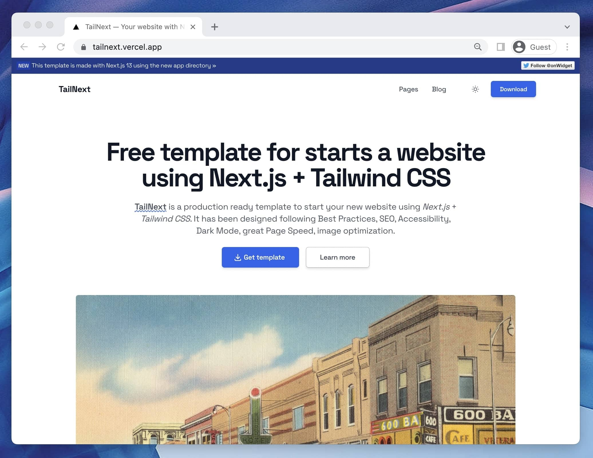

# Tailnext

## SEO de Nexo de Asystec

La página oficial del producto es **https://asystec.io/agente-nexo**. Mantener esa URL como canónica; la portada presenta Asystec y enlaza al producto. Usar «Nexo de Asystec» y «Agente Nexo» de forma consistente en contenido público y perfiles oficiales.

El título y la descripción se definen en `src/shared/data/agente-nexo.data.ts`. Las preguntas de esa misma fuente se muestran en la página y en JSON-LD. Los ejemplos describen procesos configurables, no integraciones garantizadas para todas las empresas. No añadir precios, testimonios ni resultados sin evidencia.

### Publicación y comprobación en buscadores

1. Ejecutar `npm run lint` y `npm run build`. El postbuild genera `robots.txt` y el sitemap; esos archivos están ignorados por Git y deben generarse en cada despliegue.
2. Tras desplegar, verificar que `/agente-nexo` devuelve HTTP 200, contiene el título y el contenido nuevos en HTML, conserva su canonical y aparece en `/sitemap-0.xml`.
3. En la propiedad de `asystec.io` de [Google Search Console](https://search.google.com/search-console), inspeccionar `https://asystec.io/agente-nexo`: revisar indexación, último rastreo y canónica elegida por Google. Probar la URL publicada y solicitar indexación una vez que la nueva versión esté en producción. Inspeccionar también la portada actualizada.
4. Enviar `https://asystec.io/sitemap.xml` en Search Console y Bing Webmaster Tools si todavía no está registrado. No usar los antiguos endpoints de ping de sitemaps ni la Indexing API para una landing comercial.
5. Si falta verificar la propiedad, usar el registro DNS que indique Google o el valor real de `NEXT_PUBLIC_GOOGLE_SITE_VERIFICATION` (ver `.env.example`). No inventar códigos ni sustituir una verificación existente. La verificación por DNS no necesita una etiqueta HTML.

### Medición y siguientes acciones

- Guardar el estado y las métricas disponibles como referencia. Comparar periodos equivalentes (por ejemplo, 28 días), separando Costa Rica, dispositivo y consultas de marca: «nexo asystec», «nexo de asystec» y «agente nexo». Revisar «nexo» por separado por su ambigüedad con otras marcas y significados.
- Medir impresiones, clics, CTR, posición media y qué URL aparece para esas consultas; la posición media no representa una posición fija para todos los usuarios. Para consultas de Nexo, observar si Google empieza a elegir la página del producto en vez de la portada.
- Mantener el enlace a la página oficial en los perfiles propios y, cuando exista material real aprobado, publicar ejemplos de procesos con sus límites, resultados y fuentes. No comprar enlaces ni crear menciones o reseñas ficticias.
- El rastreo puede tardar días o semanas. Ni los metadatos ni el schema garantizan primer puesto o inclusión en respuestas con IA. Referencias: [solicitar nuevo rastreo](https://developers.google.com/search/docs/crawling-indexing/ask-google-to-recrawl), [títulos en Google](https://developers.google.com/search/docs/appearance/title-link), [funciones de IA](https://developers.google.com/search/docs/appearance/ai-features).

**Tailnext** is a free and open-source template to make your website using **[NextJS](https://nextjs.org/) + [Tailwind CSS](https://tailwindcss.com/)**. Ready to start a new project and designed taking into account best practices.

## Features

- ✅ Integration with **Tailwind CSS** supporting **Dark mode**.
- ✅ **Production-ready** scores in [Lighthouse](https://web.dev/measure/) and [PageSpeed Insights](https://pagespeed.web.dev/) reports.
- ✅ **Image optimization** and **Font optimization**.
- ✅ Fast and **SEO friendly blog**.
- ✅ Generation of **project sitemap** and **robots.txt** based on your routes.

<br>



[](https://onwidget.com)
[](https://github.com/onwidget/tailnext/blob/main/LICENSE.md)
[](https://github.com/onwidget)
[](https://github.com/onwidget/tailnext#contributing)
[](https://snyk.io/test/github/onwidget/tailnext)

<br>

<details open>
<summary>Table of Contents</summary>

- [Demo](#demo)
- [Getting started](#getting-started)
  - [Project structure](#project-structure)
  - [Commands](#commands)
  - [Configuration](#configuration)
  - [Deploy](#deploy)
- [Roadmap](#roadmap)
- [Contributing](#contributing)
- [Acknowledgements](#acknowledgements)
- [License](#license)

</details>

<br>

## Demo

📌 [https://tailnext.vercel.app/](https://tailnext.vercel.app/)

<br>

## Getting started

- Clone: `git clone https://github.com/onwidget/tailnext.git`
- Enter in the directory: `cd tailnext`
- Install dependencies: `npm install`
- Start the development server: `npm run dev`
- View project in local environment: `localhost:3000`

### Project structure

Inside **Tailnext** template, you'll see the following folders and files:

```
/
├── .storybook/
├── app/
│   ├── (blog)
│   │   ├── [slug]
|   |   |   └── page.js
|   |   └── blog
|   |       └── page.js
│   ├── head.js
│   ├── layout.js
│   └── page.js
├── public/
│   └── favicon.svg
├── src/
│   ├── assets/
│   │   ├── images/
|   |   └── styles/
|   |       └── base.css
│   ├── components/
│   │   ├── atoms/
|   |   └── widgets/
|   |       ├── Header.astro
|   |       ├── Footer.astro
|   |       └── ...
│   │── content/
│   |   └── blog/
│   |       ├── demo-post-1.md
│   |       └── ...
│   ├── stories/
│   ├── utils/
│   └── config.mjs
├── package.json
└── ...
```

[](https://githubbox.com/onwidget/tailnext/tree/main)

> **Seasoned next.js expert?** Delete this file. Update `config.mjs` and contents. Have fun!

<br>

### Commands

All commands are run from the root of the project, from a terminal:

| Command               | Action                                       |
| :-------------------- | :------------------------------------------- |
| `npm install`         | Install dependencies                         |
| `npm run dev`         | Starts local dev server at `localhost:3000`  |
| `npm run build`       | Build your production site to `./dist/`      |
| `npm run preview`     | Preview your build locally, before deploying |
| `npm run storybook`   | Open storybook to view stories by widgets    |
| `npm run format`      | Format codes with Prettier                   |
| `npm run lint:eslint` | Run Eslint                                   |

<br>

### Configuration

Coming soon ..

<br>

### Deploy

#### Deploy to production (manual)

You can create an optimized production build with:

```shell
npm run build
```

Now, your website is ready to be deployed. All generated files are located at
`dist` folder, which you can deploy the folder to any hosting service you
prefer.

#### Deploy to Netlify

Clone this repository on own GitHub account and deploy to Netlify:

[](https://app.netlify.com/start/deploy?repository=https://github.com/onwidget/tailnext.git)

#### Deploy to Vercel

Clone this repository on own GitHub account and deploy to Vercel:

[](https://vercel.com/new/clone?repository-url=https%3A%2F%2Fgithub.com%2Fonwidget%2Ftailnext)

<br>

## Roadmap

Coming soon ..

<br>

## Contributing

If you have any idea, suggestions or find any bugs, feel free to open a discussion, an issue or create a pull request.
That would be very useful for all of us and we would be happy to listen and take action.

## Acknowledgements

Initially created by [onWidget](https://onwidget.com) and maintained by a community of [contributors](https://github.com/onwidget/tailnext/graphs/contributors).

## License

**Tailnext** is licensed under the MIT license — see the [LICENSE](https://github.com/onwidget/tailnext/blob/main/LICENSE.md) file for details.
